# Monitoreo con Prometheus y Grafana: explicación del `docker-compose.yml`

## Introducción

Este informe documenta el redespliegue del stack de monitoreo de la Etapa 6 y explica, servicio por servicio, el `docker-compose.yml` con el que se levanta.

En la práctica anterior (`crud-logs-analisis-cli`) un problema se investigaba después de ocurrido, filtrando archivos de log con `grep` y `awk`. En esta etapa el enfoque es el contrario: se mide el sistema mientras funciona, mediante **métricas**. Un log describe con detalle un evento puntual, pero hay que buscarlo y leerlo; una métrica es un número que cambia en el tiempo (peticiones por segundo, conexiones a la base, uso de CPU) y permite ver de un vistazo un pico o una caída.

El stack está formado por cinco servicios definidos en el compose:

- **`basedatos`**: el servidor MySQL.
- **`exportador`**: traduce las estadísticas internas de MySQL a un formato que Prometheus puede leer.
- **`medidor`**: cAdvisor, que mide el consumo de cada contenedor.
- **`recolector`**: Prometheus, que junta todas las métricas.
- **`tablero`**: Grafana, que las muestra en dashboards.

Además hay una pieza que **no** está en el compose: la aplicación Flask que se monitorea. Corre directamente en el host (puerto 8888) y publica sus métricas en `/metrics`. Esto condiciona la configuración de dos servicios, como se explica en las Partes 2 y 3.

El informe se organiza en dos bloques, más un anexo con las capturas de pantalla de todo el procedimiento (Figuras 1 a 22). Primero está el código completo para redesplegar el stack, en el orden en que se ejecuta. Después viene la explicación, dividida en tres partes: persistencia de datos (Parte 1), recolección de métricas (Parte 2) y visualización y topología (Parte 3), más una conclusión que las une.

### Nombres utilizados

A los servicios y archivos se les asignaron nombres propios. Esta tabla permite relacionarlos con los de la consigna:

| En la consigna | En este stack | Qué es |
|---|---|---|
| `mysql` | `basedatos` | Base de datos MySQL |
| `dbexporter` | `exportador` | Exporter de métricas de MySQL |
| `cadvisor` | `medidor` | cAdvisor, mide los contenedores |
| `prometheus` | `recolector` | Prometheus, junta las métricas |
| `grafana` | `tablero` | Grafana, los dashboards |
| `mynetwork` | `red_metricas` | La red de Docker |
| `my.cnf` | `credenciales.cnf` | Credenciales del exporter |
| `prometheus.yml` | `config-prometheus.yml` | Configuración de scraping |

La base de datos se llama `escuela` (su tabla sigue siendo `alumnos`, porque la app la consulta con ese nombre). Las contraseñas son `ClaveDb_2026` para MySQL y `GrafanaClave_26` para Grafana.

---

# Código completo

### 1. Instalar las herramientas

En este entorno el comando es `docker-compose` (con guion); el `docker compose` con espacio no está instalado.

```bash
apt-get update -qq
apt-get install -y -qq docker-compose python3-pip git
pip3 install flask mysql-connector-python prometheus-flask-exporter --break-system-packages --ignore-installed
```

### 2. Crear la carpeta y los tres archivos

```bash
mkdir -p /root/metricas
cd /root/metricas
```

`credenciales.cnf`:

```bash
cat > credenciales.cnf << 'EOF'
[client]
user=root
password=ClaveDb_2026
host=basedatos
port=3306
EOF
```

`config-prometheus.yml`:

```bash
cat > config-prometheus.yml << 'EOF'
global:
  scrape_interval: 5s

scrape_configs:
  - job_name: 'recolector'
    static_configs:
      - targets: ['localhost:9090']

  - job_name: 'contenedores'
    static_configs:
      - targets: ['medidor:8080']

  - job_name: 'base-de-datos'
    static_configs:
      - targets: ['exportador:9104']

  - job_name: 'app-alumnos'
    static_configs:
      - targets: ['host.docker.internal:8888']
EOF
```

`docker-compose.yml`:

```bash
cat > docker-compose.yml << 'EOF'
version: '3'
services:

  basedatos:
    image: mysql:latest
    restart: always
    environment:
      MYSQL_ROOT_PASSWORD: ClaveDb_2026
    networks:
      - red_metricas

  exportador:
    image: prom/mysqld-exporter:latest
    restart: always
    volumes:
      - ./credenciales.cnf:/.my.cnf:ro
    command:
      - --config.my-cnf=/.my.cnf
    depends_on:
      - basedatos
    networks:
      - red_metricas

  medidor:
    image: gcr.io/cadvisor/cadvisor:v0.47.2
    restart: always
    volumes:
      - /:/rootfs:ro
      - /var/run:/var/run:ro
      - /sys:/sys:ro
      - /var/lib/docker/:/var/lib/docker:ro
      - /dev/disk/:/dev/disk:ro
    networks:
      - red_metricas

  recolector:
    image: prom/prometheus:latest
    restart: always
    ports:
      - "9090:9090"
    volumes:
      - ./config-prometheus.yml:/etc/prometheus/prometheus.yml
    extra_hosts:
      - "host.docker.internal:host-gateway"
    networks:
      - red_metricas

  tablero:
    image: grafana/grafana:13.2.2
    restart: always
    ports:
      - "3000:3000"
    environment:
      - GF_SECURITY_ADMIN_PASSWORD=GrafanaClave_26
    depends_on:
      - recolector
    networks:
      - red_metricas

networks:
  red_metricas:
EOF
```

### 3. Levantar los contenedores

```bash
docker-compose up -d
docker-compose ps
```

### 4. Dejar corriendo la aplicación que se monitorea

La app Flask de la práctica no forma parte del compose: se clona, se adapta a los valores de este stack y se ejecuta en el host. Antes hay que esperar a MySQL y crear su base.

```bash
DB_ID=$(docker ps -qf "name=basedatos")

until docker exec $DB_ID mysqladmin ping -h 127.0.0.1 -uroot -pClaveDb_2026 --silent 2>/dev/null; do
  echo "Esperando MySQL..."; sleep 2
done

docker exec -i $DB_ID mysql -h 127.0.0.1 -uroot -pClaveDb_2026 << 'EOSQL'
CREATE DATABASE IF NOT EXISTS escuela;
USE escuela;
CREATE TABLE IF NOT EXISTS alumnos (
  id INT PRIMARY KEY AUTO_INCREMENT,
  nombre VARCHAR(50) NOT NULL,
  apellido VARCHAR(50) NOT NULL,
  fecha_nacimiento DATE NOT NULL
);
INSERT INTO alumnos (nombre, apellido, fecha_nacimiento) VALUES
  ('Lucia', 'Fernandez', '2000-04-12'),
  ('Tomas', 'Ruiz', '1999-09-30'),
  ('Camila', 'Sosa', '2001-02-18'),
  ('Bruno', 'Acosta', '1998-11-05'),
  ('Valentina', 'Ibarra', '2002-06-22');
EOSQL

cd /root
git clone --branch monitoring https://github.com/pablopedernera0/crud-python.git
cd crud-python

DB_IP=$(docker inspect $DB_ID --format '{{range .NetworkSettings.Networks}}{{.IPAddress}}{{end}}')
sed -i "s/172.18.0.2/$DB_IP/" app.py
sed -i 's/mysecretpassword/ClaveDb_2026/' app.py
sed -i 's/"database": "alumnos"/"database": "escuela"/' app.py

grep -A7 DB_CONFIG app.py

nohup python3 app.py > app.log 2>&1 &
```

### 5. Verificar que se miden las tres fuentes

```bash
curl -s http://127.0.0.1:8888/metrics | head -20
```

Luego, en el puerto 9090 (**Status → Target health**), los cuatro targets tienen que figurar en estado `UP`.

### 6. Configurar Grafana

Este paso se hace desde el navegador y tiene ocho partes. Los nombres de los menús corresponden a **Grafana 13.2.2**, la versión fijada en el compose; en otras versiones pueden estar en otro lugar. Las capturas de cada parte están en el Anexo.

#### 6.1 Entrar a Grafana

1. Abrí Grafana en el puerto 3000. En una máquina propia la dirección es `http://localhost:3000`. En Killercoda, hacé clic en el ícono de menú (≡) arriba a la derecha, elegí **Traffic / Ports**, escribí `3000` en **Custom Ports** y hacé clic en **Access** (Figuras 13 y 14).
2. Ingresá con usuario `admin` y contraseña `GrafanaClave_26` (Figura 15). Si Grafana propone cambiar la contraseña, se puede omitir.

#### 6.2 Conectar Grafana con Prometheus

1. En el menú lateral izquierdo, andá a **Connections → Data sources**.
2. Hacé clic en **Add data source** y elegí **Prometheus**.
3. En **Connection → Prometheus server URL** escribí:
   ```
   http://recolector:9090
   ```
   Se usa el nombre del servicio y no `localhost`, porque Grafana y Prometheus están en contenedores distintos.
4. Bajá hasta el final de la página y hacé clic en **Save & test**. Tiene que aparecer un mensaje de conexión exitosa (Figura 16).

#### 6.3 Crear el dashboard y abrir el editor de paneles

1. En el menú lateral, andá a **Dashboards**.
2. Arriba a la derecha, hacé clic en **New → New dashboard**.
3. Si Grafana pregunta por el diseño del tablero, elegí **Auto grid**.
4. Hacé clic en **Add visualization** (en algunas versiones es la tarjeta **Panel** del menú **Add** de la derecha). Si pide una fuente de datos, elegí **prometheus**.

Se abre el editor del panel (*Edit panel*), que tiene tres zonas: el gráfico, arriba a la izquierda; la sección **Queries**, abajo, donde se escribe la consulta; y las opciones a la derecha (**Suggestions** y **All visualizations**).

#### 6.4 Panel 1: "Tráfico de la app"

1. En la consulta **A**, en la fila donde dice **Builder | Code**, hacé clic en **Code**.
2. En la caja de texto que aparece, pegá:
   ```
   rate(flask_http_request_duration_seconds_count[1m])
   ```
3. Hacé clic en **Run queries** o apretá `Shift + Enter`.
4. Apagá el interruptor **Table view** (arriba a la izquierda) para ver el gráfico y no una tabla.
5. A la derecha, en **All visualizations**, elegí **Time series**.
6. En las opciones del panel, en el campo **Title**, escribí `Tráfico de la app`.
7. Arriba, configurá el rango de tiempo en **Last 5 minutes** y la actualización automática en **5s**.
8. Hacé clic en **Save** (arriba a la derecha), ponele un nombre al dashboard, por ejemplo `Monitoreo`, y confirmá (Figura 17).

> **Atención:** el buscador **Search for...** de la derecha sirve para buscar tipos de gráfico, no para escribir consultas. Si la consulta se pega ahí, Grafana responde "Could not find anything matching your query".

#### 6.5 Panel 2: "Conexiones a la base"

1. Con el dashboard abierto, hacé clic en **Edit** (arriba a la derecha).
2. Hacé clic en **Add → Visualization** (o en la tarjeta **Panel**).
3. Cambiá a **Code**, pegá la consulta y ejecutala con **Run queries**:
   ```
   mysql_global_status_threads_connected
   ```
4. Elegí **Time series**, poné el título `Conexiones a la base` y guardá con **Save** (Figura 18).

#### 6.6 Panel 3: "CPU de la base"

1. En la **terminal** (no en Grafana), obtené el ID del contenedor de MySQL:
   ```bash
   docker ps -qf "name=basedatos"
   ```
   En esta práctica devolvió `966d329d8cda` (Figura 19).
2. Agregá un panel nuevo como en 6.5, cambiá a **Code** y pegá la consulta reemplazando `ID_DEL_CONTENEDOR` por el ID obtenido:
   ```
   rate(container_cpu_usage_seconds_total{id=~".*966d329d8cda.*"}[1m])
   ```
   cAdvisor identifica a cada contenedor por el ID de su grupo de control (*cgroup*) y no por su nombre, por eso se filtra por ID con la expresión regular `=~`.
3. Ejecutá con **Run queries**, poné el título `CPU de la base` y guardá con **Save** (Figuras 20 y 21).

> **Atención:** solo el primer comando (`docker ps ...`) va en la terminal. La línea `rate(...)` se escribe únicamente en Grafana; si se pega en la terminal, bash responde con un error de sintaxis.

#### 6.7 Generar carga y observar el dashboard

Con el dashboard abierto, en **Last 5 minutes** y con actualización de **5s**, ejecutá en la terminal el comando del paso 7 (Figura 22). Los paneles de tráfico y de conexiones tienen que subir mientras corre la carga y volver a bajar cuando termina.

#### 6.8 Problemas frecuentes

| Qué se ve | Causa | Cómo se soluciona |
|---|---|---|
| "Could not find anything matching your query" | La consulta se pegó en el buscador de visualizaciones | Hacer clic en **Clear** y pegarla en **Queries → Code** |
| No aparece la caja para escribir la consulta | El editor está en modo **Builder** | Cambiar a **Code** |
| Se ve una tabla en lugar de un gráfico | **Table view** está activado | Apagar el interruptor |
| El panel de tráfico dice "No data" | La app no recibió peticiones en el último minuto | Generar carga (paso 7) |
| Todos los paneles dicen "No data" | Un target caído o la URL del data source incorrecta | Revisar **Status → Target health** en Prometheus y probar la URL `http://recolector:9090` con **Save & test** |
| `bash: syntax error near unexpected token` | Se pegó la consulta `rate(...)` en la terminal | Esa línea va en Grafana, no en la terminal |

### 7. Generar carga mirando el dashboard

```bash
seq 1 1500 | xargs -P 30 -I{} curl -s -o /dev/null http://127.0.0.1:8888/
```

---

# Explicación del `docker-compose.yml`

## Parte 1 — Persistencia de datos: `basedatos` y `exportador`

### El servicio `basedatos`

```yaml
  basedatos:
    image: mysql:latest
    restart: always
    environment:
      MYSQL_ROOT_PASSWORD: ClaveDb_2026
    networks:
      - red_metricas
```

`basedatos` es el servidor MySQL donde se guarda la información de la aplicación.

**Sintaxis YAML.** YAML no usa llaves ni punto y coma: la estructura se define con la **indentación** (aquí, dos espacios), y lo que está más adentro pertenece a lo que tiene arriba. `services:` agrupa todos los servicios y cada uno es una clave dentro de él. Los pares `clave: valor` son el elemento básico (`image: mysql:latest`), `environment` es un bloque anidado con las variables, y las **listas** llevan un guion al comienzo de cada elemento (`- red_metricas`). `restart: always` indica que Docker debe volver a levantar el contenedor si se cae o si se reinicia la máquina.

**Por qué la contraseña va por variable de entorno.** La imagen oficial de MySQL lee `MYSQL_ROOT_PASSWORD` la primera vez que arranca, para crear el usuario `root` con esa clave. Pasarla como variable evita escribirla dentro de la imagen y permite cambiarla sin reconstruirla: la configuración queda separada del software. En este laboratorio la contraseña queda en texto plano dentro del compose; en un entorno real se guardaría en un archivo `.env` fuera del repositorio o en los *secrets* de Docker.

**Sobre la persistencia.** El compose no declara un volumen con nombre para `/var/lib/mysql`. La imagen crea por su cuenta un volumen anónimo, de modo que los datos sobreviven a un reinicio del contenedor, pero si el contenedor se elimina y se crea de nuevo se pierde el acceso a ellos. Por eso, al redesplegar el stack desde cero, hay que repetir la creación de la base (paso 4).

### El servicio `exportador`

```yaml
  exportador:
    image: prom/mysqld-exporter:latest
    restart: always
    volumes:
      - ./credenciales.cnf:/.my.cnf:ro
    command:
      - --config.my-cnf=/.my.cnf
    depends_on:
      - basedatos
    networks:
      - red_metricas
```

`exportador` se conecta a MySQL, lee sus estadísticas internas (conexiones, consultas, estado del motor) y las publica en formato Prometheus en el puerto 9104. Gracias a él existe la métrica `mysql_global_status_threads_connected` que se grafica en el dashboard.

**Sintaxis YAML.** En `volumes`, cada elemento de la lista sigue el formato `origen:destino:modo`: el archivo `./credenciales.cnf` de la carpeta del proyecto (ruta relativa al compose) se monta como `/.my.cnf` dentro del contenedor. `command` es una lista con los argumentos que recibe el programa al iniciar, y `depends_on` es una lista de los servicios de los que este depende.

**Para qué se monta el archivo de credenciales en solo lectura.** El sufijo `:ro` significa *read-only*. El exporter únicamente necesita leer el usuario y la contraseña, nunca modificarlos, así que con `:ro` el contenedor no puede alterar ni borrar el archivo del host. Además, entregar las credenciales mediante un archivo evita ponerlas en la línea de comandos, donde cualquiera podría verlas con `docker inspect`. El archivo contiene `host=basedatos`: el exporter localiza la base por el **nombre del servicio**, gracias a la red común (Parte 3).

**La relación de dependencia.** `depends_on: - basedatos` hace que Compose arranque `basedatos` antes que `exportador`, lo cual tiene sentido porque el exporter no tiene nada que leer si la base no existe. Pero conviene entender su límite: solo garantiza el **orden de arranque**, no que MySQL esté listo para aceptar conexiones, algo que tarda unos segundos. Por eso, en el paso 4, se espera explícitamente con `mysqladmin ping` antes de crear la base.

---

## Parte 2 — Recolección de métricas: `medidor` y `recolector`

### El servicio `medidor`

```yaml
  medidor:
    image: gcr.io/cadvisor/cadvisor:v0.47.2
    restart: always
    volumes:
      - /:/rootfs:ro
      - /var/run:/var/run:ro
      - /sys:/sys:ro
      - /var/lib/docker/:/var/lib/docker:ro
      - /dev/disk/:/dev/disk:ro
    networks:
      - red_metricas
```

`medidor` (cAdvisor) mide cuánta CPU, memoria, red y disco consume cada contenedor del host, y lo expone en el puerto 8080. De allí sale `container_cpu_usage_seconds_total`, la métrica usada en el panel de CPU.

**Sintaxis YAML.** La imagen proviene de otro registro (`gcr.io`, el de Google, en lugar de Docker Hub) y tiene una **versión fija** (`v0.47.2`) en vez de `latest`, para que el comportamiento no cambie solo. Los volúmenes usan rutas absolutas del host, a diferencia del `./credenciales.cnf` de la Parte 1, que era relativo a la carpeta del compose.

**Por qué monta rutas del host en solo lectura.** Un contenedor está aislado y, por sí solo, no puede ver qué consumen los demás. Para medirlos, cAdvisor necesita observar archivos del host: `/sys` (donde el kernel registra el consumo de recursos de cada grupo de procesos), `/var/lib/docker` (los datos de los contenedores), `/var/run` y `/dev/disk`. Todo se monta con `:ro` porque cAdvisor solo **observa**: así, aunque el contenedor tuviera una vulnerabilidad, no podría modificar archivos del host.

**Puerto.** `medidor` no tiene sección `ports:`. Escucha en el 8080 únicamente dentro de la red de Docker, y Prometheus lo alcanza como `medidor:8080`. No se publica al host porque ninguna persona necesita entrar a él directamente.

### El servicio `recolector`

```yaml
  recolector:
    image: prom/prometheus:latest
    restart: always
    ports:
      - "9090:9090"
    volumes:
      - ./config-prometheus.yml:/etc/prometheus/prometheus.yml
    extra_hosts:
      - "host.docker.internal:host-gateway"
    networks:
      - red_metricas
```

`recolector` (Prometheus) es quien **recolecta** las métricas de forma activa: cada 5 segundos va a buscar ("scrapea") el endpoint `/metrics` de cada target y guarda los valores como series de tiempo. Eso mismo es lo que se ve al consultar la app con `curl`:

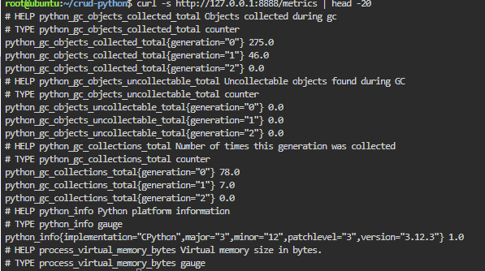

Qué targets consulta y con qué frecuencia lo define `config-prometheus.yml`. En él, `scrape_interval: 5s` fija el intervalo y `scrape_configs` es una lista de *jobs*, cada uno con su `job_name` y una lista `static_configs` con sus `targets`. Hay cuatro: el propio Prometheus, los contenedores (`medidor:8080`), la base (`exportador:9104`) y la aplicación (`host.docker.internal:8888`). En la página **Status → Target health** se ve el estado de cada uno:

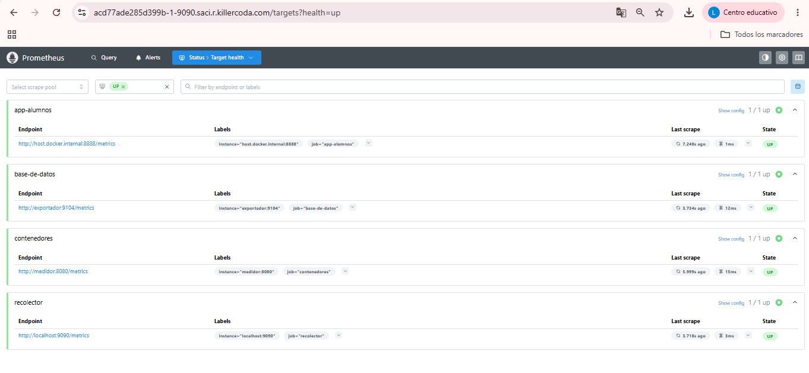

**Sintaxis YAML.** En `volumes`, el origen (`./config-prometheus.yml`) y el destino (`/etc/prometheus/prometheus.yml`) tienen nombres distintos: el archivo se llama de una forma en la carpeta del proyecto y de otra dentro del contenedor, que es donde Prometheus lo busca por defecto. El valor de `ports` va entre comillas y tiene el formato `puerto_del_host:puerto_del_contenedor`; las comillas evitan que YAML interprete los dos puntos como un `clave: valor`. Por último, `extra_hosts` es una lista de entradas `nombre:ip` que se agregan al archivo `/etc/hosts` del contenedor.

**Qué puerto se publica y por qué.** Se publica el `9090:9090`, para poder abrir la interfaz web de Prometheus desde fuera de la red Docker y consultar métricas o revisar el estado de los targets. Es el único de esta parte que se expone al host.

**Qué resuelve `extra_hosts` con `host.docker.internal`.** Tres de los targets son contenedores y se encuentran por nombre de servicio, pero la aplicación Flask corre **en el host**, fuera de Docker. Desde dentro de un contenedor, `localhost` apunta al propio contenedor y no al host, así que Prometheus no podría llegar a la app. Además, en Linux el nombre `host.docker.internal` no existe por defecto. La línea `"host.docker.internal:host-gateway"` lo crea: `host-gateway` es un valor especial que Docker reemplaza por la dirección IP del host. Con eso, el target `host.docker.internal:8888` funciona.

---

## Parte 3 — Visualización y topología: `tablero` y la red `red_metricas`

### El servicio `tablero`

```yaml
  tablero:
    image: grafana/grafana:13.2.2
    restart: always
    ports:
      - "3000:3000"
    environment:
      - GF_SECURITY_ADMIN_PASSWORD=GrafanaClave_26
    depends_on:
      - recolector
    networks:
      - red_metricas
```

`tablero` (Grafana) no recolecta nada por sí mismo: es una capa de visualización que se conecta a Prometheus y arma paneles con las métricas que este ya guardó. Se accede por el puerto 3000, con el usuario `admin` y la contraseña definida en `GF_SECURITY_ADMIN_PASSWORD`.

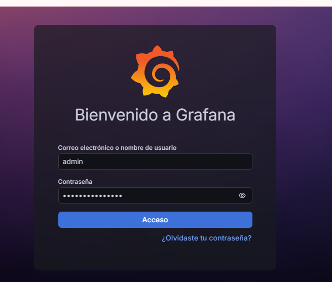

**Sintaxis YAML.** La versión de la imagen está fija en 13.2.2 porque la interfaz de Grafana cambia entre versiones y los pasos de este informe corresponden a esa. Además, `environment` está escrito acá como **lista** (`- CLAVE=valor`), mientras que en `basedatos` era un **bloque** (`CLAVE: valor`). Compose acepta ambas formas y significan lo mismo.

**Por qué Grafana depende de Prometheus.** Sin su fuente de datos, un dashboard no tiene nada que mostrar. Con `depends_on: - recolector`, Compose arranca Prometheus primero. Igual que en la Parte 1, esto solo controla el orden de arranque y no garantiza que Prometheus ya esté listo para responder consultas.

Una vez dentro, se agrega Prometheus como fuente de datos con la URL `http://recolector:9090`. Se usa el **nombre del servicio** y no `localhost`, porque Grafana y Prometheus están en contenedores distintos y `localhost` apuntaría al propio contenedor de Grafana.

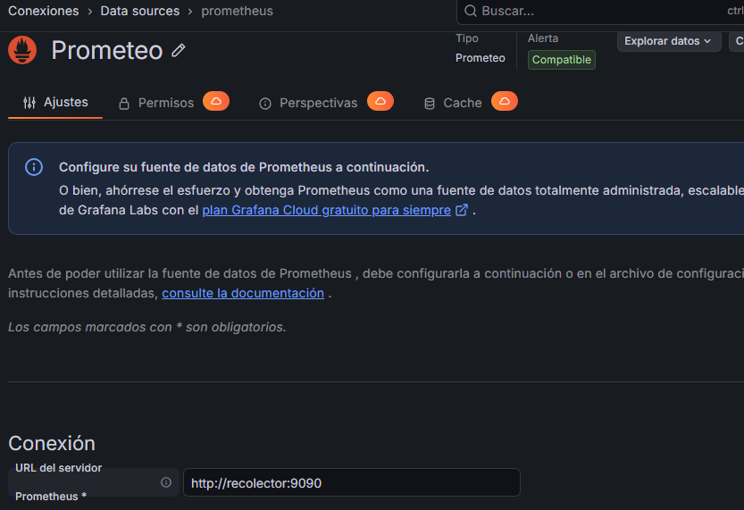

Con la fuente conectada se crean los paneles con las consultas del paso 6 (el procedimiento detallado, clic por clic, está en ese mismo paso):

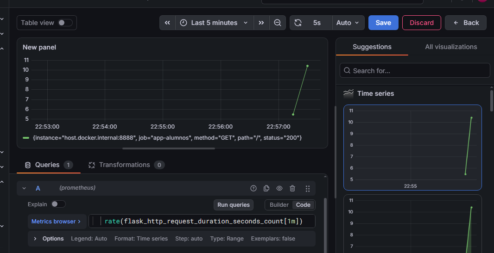

### La red `red_metricas`

```yaml
networks:
  red_metricas:
```

Al final del compose se declara una red propia de Docker (de tipo *bridge*, la configuración por defecto), a la que los cinco servicios se conectan con su lista `networks: - red_metricas`. En YAML, `red_metricas:` sin nada indentado debajo es una clave con valor vacío, y Compose aplica la configuración por defecto. Es un bloque de nivel superior, al mismo nivel que `services:`. Como el proyecto está en la carpeta `metricas`, Compose le antepone ese nombre y en el sistema la red aparece como `metricas_red_metricas`.

**Cómo permite resolver por nombre.** En una red definida por el usuario, Docker incluye un servidor DNS interno: cada contenedor se registra con el nombre de su servicio, de modo que los demás pueden encontrarlo sin conocer su IP, que puede cambiar cada vez que se recrea. Entre los cinco servicios esto se usa en tres lugares:

| Quién se conecta | A quién | Dónde está configurado |
|---|---|---|
| `exportador` | `basedatos:3306` | `credenciales.cnf` (`host=basedatos`) |
| `recolector` | `medidor:8080` y `exportador:9104` | `config-prometheus.yml` |
| `tablero` | `recolector:9090` | Data source cargado en la interfaz de Grafana |

**La excepción: la aplicación Flask.** Como corre en el host y no dentro de la red, no puede resolver `basedatos` por nombre. Por eso, en el paso 4, se consulta la IP real del contenedor con `docker inspect` y se reemplaza dentro de `app.py` con `sed`. Es el camino inverso al de `extra_hosts`, que permite que Prometheus llegue hasta la app.

---

## Conclusión

Las tres partes forman una cadena completa. `basedatos` guarda los datos y `exportador` los convierte en métricas (Parte 1). `medidor` mide los contenedores y `recolector` junta, cada 5 segundos, las métricas de todos los targets, incluida la aplicación que corre fuera de Docker gracias a `extra_hosts` (Parte 2). Finalmente `tablero` consulta a Prometheus y las muestra en un dashboard, mientras que la red `red_metricas` es lo que permite que los servicios se encuentren por nombre (Parte 3).

Para comprobarlo se generó carga con el dashboard abierto (actualización automática cada 5 segundos y rango de tiempo *Last 5 minutes*): 1500 peticiones, 30 en simultáneo. Mientras la carga corría, el panel de tráfico subió de golpe y las conexiones a la base se movieron en sincronía con las peticiones, sin abrir ningún archivo. En la práctica de logs, en cambio, había que esperar a que terminara la carga, buscar el archivo y filtrarlo para recién entonces notar el pico.

Ambas herramientas se complementan: las métricas sirven para **detectar y avisar al instante**, y los logs para **investigar el detalle después**. En un entorno de producción se usan las dos.

Este compose está pensado para una práctica. En un entorno real convendría hacer algunos cambios:

- Sacar las contraseñas del archivo (`.env` o *secrets*).
- Agregar un volumen con nombre para los datos de MySQL.
- Fijar la versión de todas las imágenes en lugar de usar `latest`.
- Montar `config-prometheus.yml` con `:ro`, ya que el contenedor solo necesita leerlo.

## Anexo — Capturas de pantalla

En este anexo se muestran, en el orden en que se realizaron, las capturas de todo el procedimiento.

### A. Preparación y archivos de configuración (pasos 1 y 2)

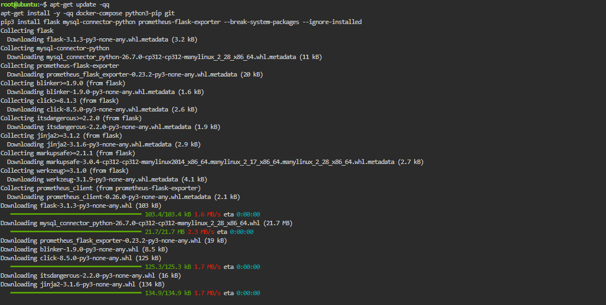

**Figura 1.** Instalación de `docker-compose`, `python3-pip` y `git`, e inicio de la instalación de las librerías de Python.

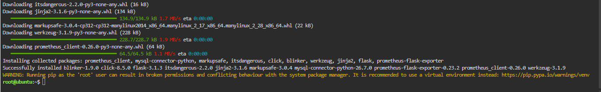

**Figura 2.** Final de la instalación de `flask`, `mysql-connector-python` y `prometheus-flask-exporter`.

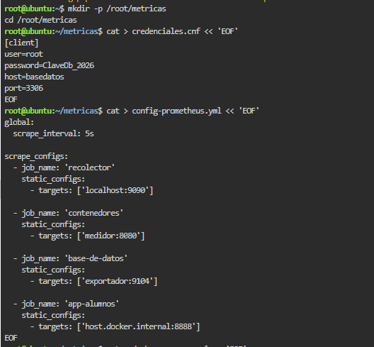

**Figura 3.** Creación de la carpeta `metricas` y de los archivos `credenciales.cnf` y `config-prometheus.yml`.

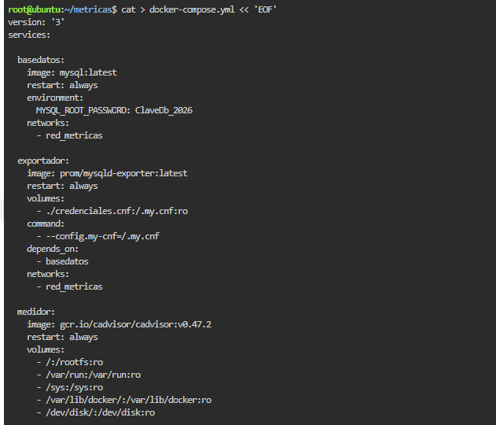

**Figura 4.** Creación del `docker-compose.yml`: servicios `basedatos`, `exportador` y `medidor`.

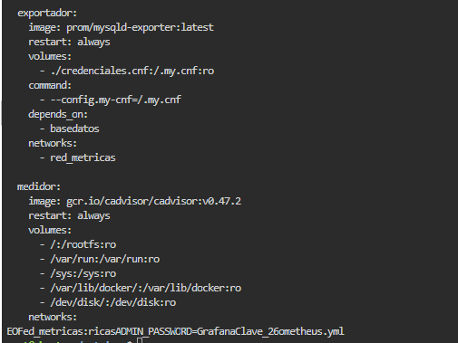

**Figura 5.** Continuación del `docker-compose.yml`: servicio `medidor` y cierre del archivo.

### B. Despliegue de los contenedores (paso 3)

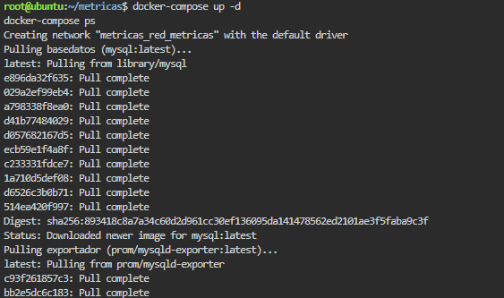

**Figura 6.** `docker-compose up -d`: creación de la red y descarga de las imágenes.

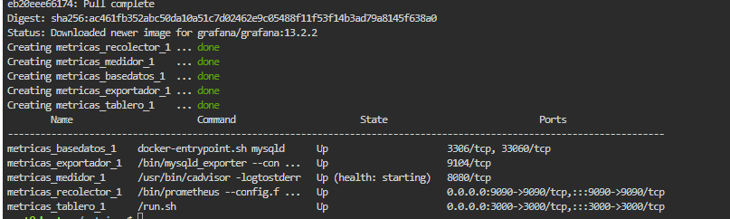

**Figura 7.** Los cinco servicios creados y `docker-compose ps` con todos en estado `Up`.

### C. Aplicación que se monitorea (paso 4)

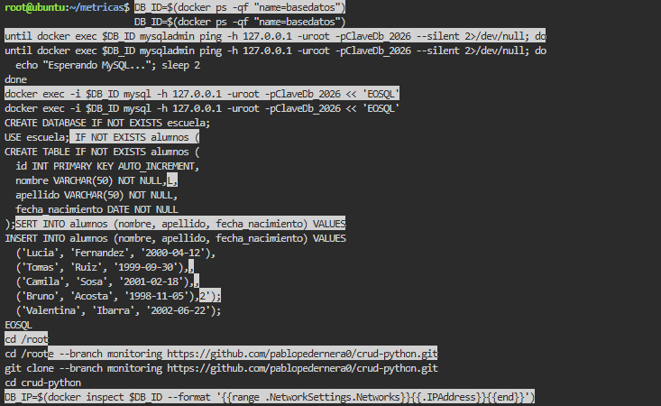

**Figura 8.** Espera a MySQL, creación de la base `escuela` y de la tabla `alumnos` con datos de prueba, y clonado del repositorio de la app.

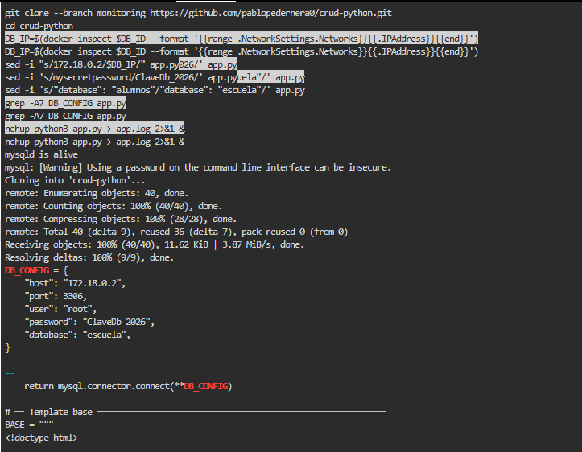

**Figura 9.** Reemplazo con `sed` de la IP, la contraseña y la base en `app.py`, y arranque de la app con `nohup`.

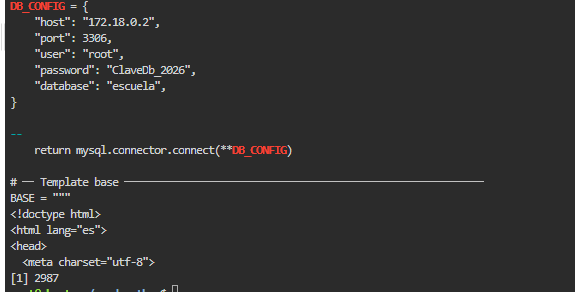

**Figura 10.** Configuración `DB_CONFIG` resultante y la app corriendo en segundo plano.

### D. Verificación de las fuentes de métricas (paso 5)


**Figura 11.** Respuesta de `http://127.0.0.1:8888/metrics`, con las métricas que publica la app.


**Figura 12.** Prometheus, **Status → Target health**: los cuatro targets (`app-alumnos`, `base-de-datos`, `contenedores` y `recolector`) en estado UP.

### E. Configuración de Grafana (paso 6)

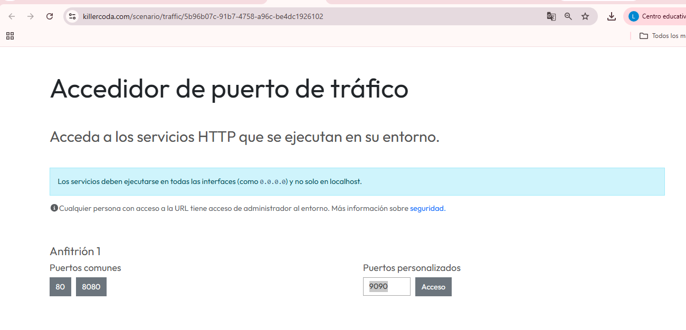

**Figura 13.** Acceso al puerto 9090 (Prometheus) desde la página de puertos de Killercoda.

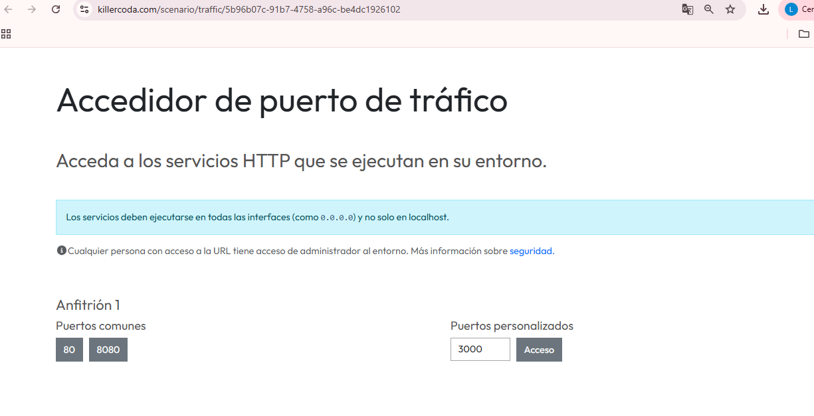

**Figura 14.** Acceso al puerto 3000 (Grafana) desde la misma página.


**Figura 15.** Pantalla de inicio de sesión de Grafana con el usuario `admin`.


**Figura 16.** Data source de Prometheus con la URL `http://recolector:9090`.


**Figura 17.** Panel de tráfico: consulta `rate(flask_http_request_duration_seconds_count[1m])` en modo **Code**.

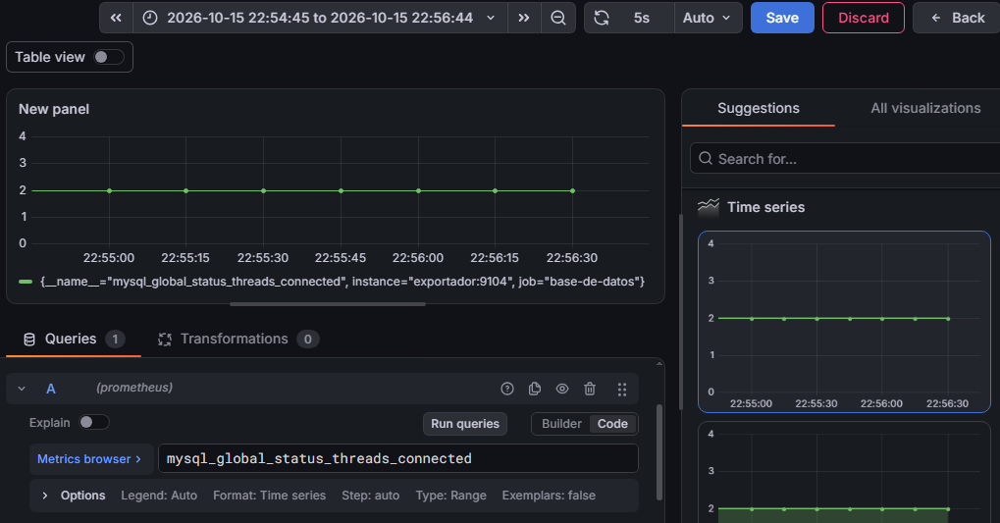

**Figura 18.** Panel de conexiones: consulta `mysql_global_status_threads_connected`.

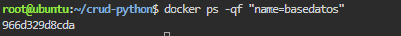

**Figura 19.** ID del contenedor de MySQL obtenido con `docker ps -qf "name=basedatos"`.

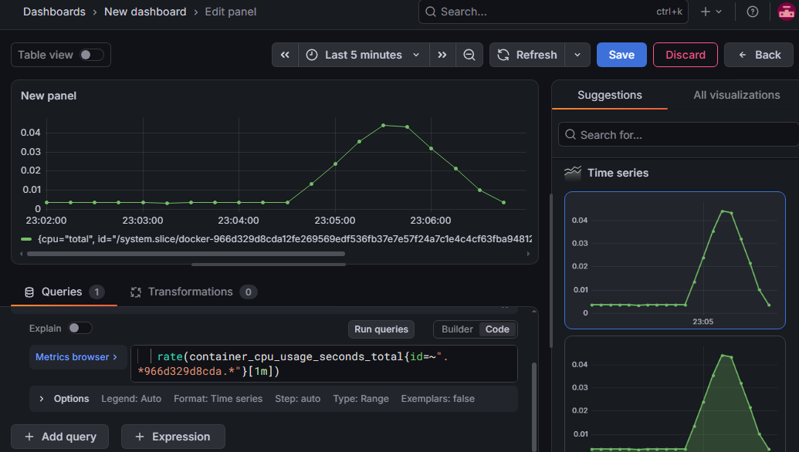

**Figura 20.** Panel de CPU de la base con la consulta filtrada por el ID del contenedor.

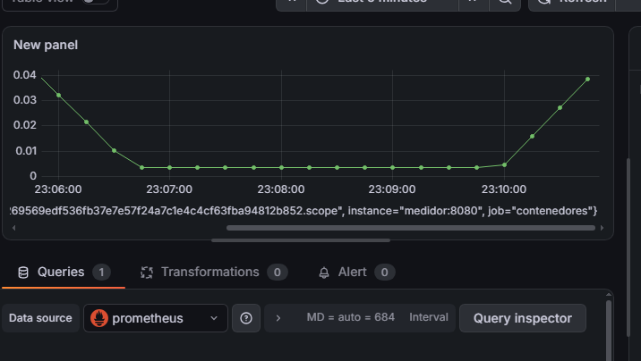

**Figura 21.** Gráfico de CPU del contenedor de MySQL medido por cAdvisor (`job="contenedores"`).

### F. Prueba de carga (paso 7)

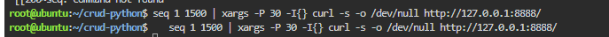

**Figura 22.** Comando `seq 1 1500 | xargs -P 30 ...` que genera la carga sobre la app.

---

---

## Evidencia en Git

Este informe lo realicé de forma individual. Aun así, el historial del repositorio sigue la lógica de la consigna: cada parte se commiteó por separado, con un mensaje que explica qué se documentó y por qué se lo entendió de esa manera, y la introducción, la conclusión y el anexo quedaron en commits aparte. De ese modo se puede ver en el historial cómo se fue armando el informe, parte por parte.

| # | Commit | Qué contiene | Qué idea central se explica |
|---|---|---|---|
| 1 | Introducción y código completo | Introducción, tabla de nombres y código de redespliegue (pasos 1 a 7) | La diferencia entre logs y métricas, y por qué la app Flask corre en el host y no en el compose |
| 2 | Parte 1 | `basedatos` y `exportador` | Contraseña por variable de entorno, volumen anónimo, credenciales en solo lectura y límite de `depends_on` |
| 3 | Parte 2 | `medidor` y `recolector` | Scraping cada 5 segundos, rutas del host montadas en `:ro` y `extra_hosts` con `host-gateway` |
| 4 | Parte 3 | `tablero` y `red_metricas` | DNS interno de Docker, resolución por nombre de servicio y la excepción de la app Flask |
| 5 | Conclusión | Comparación entre logs y métricas, resultado de la carga y mejoras para producción | Métricas para detectar al instante, logs para investigar el detalle |
| 6 | Anexo | Anexo con las Figuras 1 a 22 y sus epígrafes, y la carpeta `imagenes/` con las capturas | Evidencia visual de cada paso, desde la instalación hasta el dashboard |
| 7 | Evidencia en Git | Esta sección | Cómo está organizado el historial |

Para ver el historial completo:

```bash
git log --oneline
```
